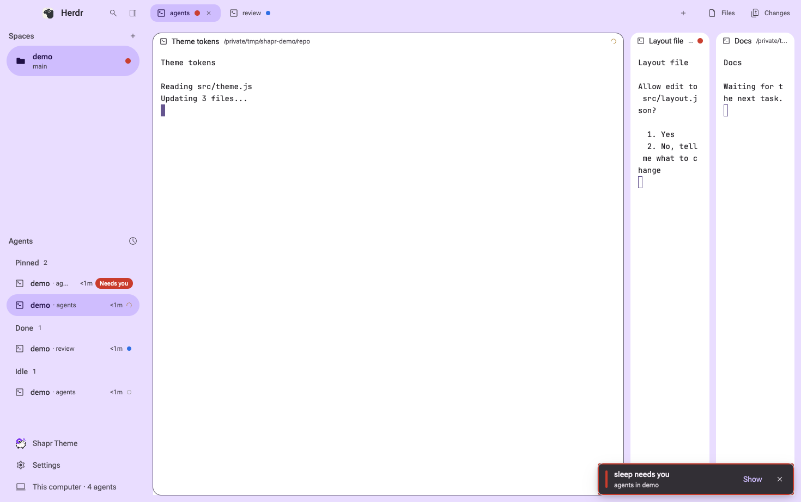

# Shapr

Herdr's default window, restyled in Material 3 Expressive: a tinted frame (the seed color's tone 90
in light mode) holding white terminal cards, a navigation-drawer sidebar with your spaces over your
agents, a tab bar of pill tabs, and MD3 menus, dialogs and snackbars for everything Herdr opens.
One seed color, a contrast level, density, corners and motion, all set in its Theme window,
restyle every part at once. For herdr-app 0.1.13.

## What you see

Left to right, on the theme's `canvas` (MD3 surface: `#e9ddff` light, `#141218` dark at the
default seed `#6750A4`), no title bar, the macOS traffic lights at 12, 17. Type is Roboto Flex
throughout (the MD3 type scale in thin weights: display and headline 300, title large, body and
labels 400, title medium and small 500).

- **Sidebar** (268px; 44–480; under 160px it turns into a rail), on `canvas`:
  - **Brand bar** (48px, drags the window): after the traffic lights (76px left pad on macOS,
    16 elsewhere) Herdr's 24px mark (`frame/welcome/herdr.png`, rounded 8) and "Herdr" in title
    medium emphasized; then two 32px standard icon buttons, Search (opens the picker) and the
    sidebar toggle (`dock_to_left`).
  - **Spaces** (half of what is left, min 90): a subheader "Spaces" with `+`, then one 40px drawer
    item per space: a folder icon (outlined, filled when active; a worktree shows `call_split` one
    step in), the space's name and a quiet "↑2 ↓1" count. The active space is a full pill on
    `selected` (`#cfbdfe` light) with its branch as a second line (56px). Only a blocked space shows
    a mark (the blocked dot). More than one machine: a subheader per machine that folds it.
  - **Agents** (the other half, min 90): a subheader "Agents" with a sort button (`schedule`:
    Priority or Grouped by space). Groups under quiet subheaders in title small with a plain count:
    Pinned, then Needs you, Done, Working, Idle (Priority) or one per space (Grouped). A row is 40px:
    the program's icon, "space · detail" (a tab someone named or the agent's own title),
    the time since its last change ("<1m") and its status mark. Sub-agents hang under their parent
    as 32px rows with tree lines.
  - **Footer** (136px = 16 + 3 rows of 40, set off by space, no line): three drawer items,
    "Shapr Theme" (the 20px Shapr logo, opens the Theme window), "Settings" (Herdr's own, with a
    primary dot when an update is ready) and the machine row "This computer · 4 agents" (or
    "3 machines · …"), which cross-fades to "+ Add machine" when pointed at.
- **Work column**:
  - **Tab bar** (48px, drags the window), on `canvas`: one 32px text button per tab, the program's
    16px icon, its name (an unnamed tab takes its program's name, a zoomed one ends in " Z"; at most
    170px), its status mark (not for idle), and on the active tab a 24px close. The active tab is a
    pill on `selected`; others are `on-surface-variant`. At the right: `+` (the new menu), 8px of
    space, then Files and Changes as text buttons with icons, selected while their panel shows;
    on Windows and Linux also minimize, maximize and close.
  - **Body** (12px padding, 12px gaps): the active tab's panes as cards, 16px radius (the corner
    setting's large step), filled with `background` (`#ffffff` light, `#211f24` dark), a 1px
    `secondary` ring on the focused pane, 14 × 12 terminal padding. Each card has a 30px header on
    the card's own fill (no line): the program icon (14px), the name in label large, the folder in
    body small `on-surface-variant` (home as `~`), and the status mark for working, blocked or done.
  - **Side panel** (368px; 280–900; hidden until Files or Changes is picked): a card like the
    panes, a 48px header (title medium, a detail, actions). Files: a lazy tree of the focused
    pane's folder with git marks (added primary, modified on-surface-variant, deleted error) and a
    read-only preview with a back arrow. Changes: "Changes", a count pill, "+n −n" in primary and
    error, the changed files, the selected file's diff (removed and added lines marked by a bar,
    not a red row), and a commit message field over a filled "Commit" button.
- **Toasts**: floating at the bottom right of the work area, 360px wide, at most three, newest at
  the bottom: MD3 snackbars on `inverse_surface` with a "Show" action and a close X. "<agent> needs
  you" has the blocked strip and outline and stays until answered; "<agent> finished" goes after
  6 s.

Status colors are Herdr's own and never seed-tinted: working `#9a6700` / `#e5c07b`, blocked
`#c93c2c` / `#f0705f`, done `#2f6fe4` / `#76a8ff`, idle `#a8a8aa` / `#696a6d` (light / dark).

## How it behaves

- **Agent status**, the same mark everywhere (pane header, tab, agents row, picker): working a
  12px `progress_activity` spinner in the working color, turning (still under reduced motion);
  blocked a 10px blocked dot that breathes (opacity 0.55–1 every 1.2 s), and in the agents list,
  where no "Needs you" header says it already, a filled "Needs you" pill in label small, the
  loudest thing in the sidebar; done an 8px filled dot in the done color; idle an 8px hollow ring.
  Looking at a done agent turns it idle, but it stays under Done until you leave it.
- **Sidebar**: click a space to switch, right-click for its menu (Rename, New worktree, Open
  worktree, Remove worktree for a worktree, Close), drag to reorder; worktree spaces sort under
  their checkout. Click an agent to focus it; pointing at a row turns its time into a pin button.
  The toggle narrows the sidebar to a rail (76px on macOS, 44 elsewhere) of 32px pills (a space's
  number, an agent's number and mark) and back to the width it had; dragging the edge under 160
  does the same.
- **Tabs**: click to select, double-click to rename (shapr-prompt), drag onto another tab to move,
  right-click for Rename, New tab, Close; the scroll wheel steps through tabs. The side panel is
  remembered per space.
- **Pane header**: click focuses the pane; pointing at it floats Split right, Split down, Zoom and
  Close over its right end on the card's fill, so nothing moves. Right-click in a terminal opens the
  terminal menu (the layout's `terminal_menu`): Split right, Split down, Zoom, where right-clicks
  go, Send back (a kept sub-agent), Close pane.
- **Overlays**, all drawn by Shapr (`frame: "none"`) and sized by their opener to exactly what
  they draw: the + menu (Terminal, Start an agent with installed agents on 1–9 and two that
  aren't, New space, New worktree…, Open worktree…), the picker (Search: a 48px search bar over
  tabs, needs-you spaces first, quiet ones folded into "earlier"; ↑/↓, Enter, ctrl+d closes a tab,
  Esc), rename and confirm dialogs (the confirm's primary is the verb, "Close space"), the worktree
  dialog, Add a machine (hosts from `~/.ssh/config`, one click each), Keybinds (filterable) and
  the Theme window.
- **Theme window** (Shapr Theme, 520px dialog): Color (Mode System/Light/Dark, which writes Herdr's
  `appearance`; eight MD3 preset seeds and a hex field; Contrast Standard/Medium/High), Size and
  shape (Density Compact/Standard/Comfortable: −4/0/+4 on every control and row; Corners
  Standard/Round), Motion (Expressive springs, Calm, Reduced), and a Preview card. Every choice
  restyles all of Shapr at once and survives a restart; Reset and Done at the foot.
- **Hover** is a state layer in the element's own shape, only where a click does something;
  nothing moves or resizes on hover. Springs overshoot a little under Expressive, not under Calm,
  and nothing moves under Reduced.
- **Keys**: `shapr-workspace-chrome` takes commands a `keys.json` can bind
  (`"alt-t": "shapr-workspace-chrome.theme"`): `new-menu`, `tab-menu`, `space-menu`,
  `terminal-menu`, `rename-tab`, `rename-space`, `theme`, `set-density-<compact|standard|comfortable>`,
  `set-corners-<standard|round>`, `set-motion-<expressive|calm|reduced>`,
  `set-contrast-<standard|medium|high>`, `seed-<rrggbb>`, `reset-theme`. Shapr ships no keys.json.

## Built from

- `layouts/shapr.json` (cloned from Herdr's `main` 0.1.12): root row, `titlebar: "none"`,
  `traffic_lights: [12, 17]`, `background: "canvas"`, `terminal_padding: [14, 12]`,
  `theme: { light: "shapr-light", dark: "shapr-dark" }`, `ui_font: "Roboto Flex"`,
  `terminal_menu: "shapr-menu"`.
  - `sidebar` column (px 268, min 44, max 480, not resizable): `brand` block (px 48,
    `window_drag`, shapr-workspace-chrome); `sidebar-lists` column of `spaces` (weight 1, min 90,
    shapr-spaces) and `agents` (weight 1, min 90, shapr-agents); `sidebar-footer` block (px 136,
    shapr-workspace-chrome `{ footer: true }`).
  - `work` column: `tabs` block (px 48, `window_drag`, shapr-tabs); `work-body` row (padding 12,
    gap 12) of `main` (`{ tab: "active" }`, pane frame: gap 12, radius 16, background
    `background`, `lone: true`, focus 1 `secondary`, header shapr-pane at 30 on top, reveal
    always) and `panel` column (hidden, px 368, min 280, max 900) holding the `panel-body` stack
    (`files` shapr-files, `changes` shapr-changes; active `files`). Floating `toasts`
    (shapr-toasts, edge bottom, align end) on `work-body`.
- 18 mods in `mods/`, each `place: "none"`, each a restyled clone of a shipped Herdr mod of the
  same name without the prefix (its `mod.json` keeps `cloned_from` with the original's hashes),
  except shapr-toasts, shapr-settings and shapr-gallery, which are Shapr's own:
  - In the layout: shapr-workspace-chrome (brand bar, footer, the commands above, and it writes
    the themes), shapr-spaces, shapr-agents, shapr-tabs, shapr-pane, shapr-files, shapr-changes,
    shapr-toasts.
  - Overlays they open: shapr-menu (popup 240 wide; tab, space, pane and global menus),
    shapr-new-menu (popup 280), shapr-picker (popup at top, offset 40, 640 × 0.8), shapr-prompt
    (dialog 400), shapr-confirm (dialog 360), shapr-worktree (dialog 460, or 560 for open),
    shapr-machine-add (dialog 560), shapr-help (dialog 560 × 0.8), shapr-settings (dialog 520 ×
    0.92), shapr-gallery (window 0.9 × 0.9: every kit component in every state, for the shot loop).
  - No shipped Herdr mod is used; the layout's only shipped art is `frame/welcome/herdr.png`.
- **The kit**: each mod has its own copy in `mods/<mod>/kit/` (a mod imports only from its own
  folder); `kit/self.js` names the mod that holds the copy. It holds the tokens (`TYPE`, `SHAPE`
  standard 4/8/12/16/20/28/32 and round 6/12/16/20/24/32/36, `H` 24/32/36/40/48, `ROW` 40/56/72,
  `SPACE` on the 4px grid, springs and durations 150/300/450 ms), `roles()` (MD3 role names over
  `theme()`), the components (button, icon button, chip, switch, checkbox, radio, segmented,
  text field, menu, list item, nav item, card, dialog, badge and `statusMark`, progress, divider,
  snackbar, keycap, search bar, panel) and `openers.js`, which sizes every overlay from what it
  draws (`menuHeight`, `dialogHeight`). Ten Material Symbols (optical size 20) in `kit/icons/`;
  the chrome's own symbols are SVGs in `mods/shapr-workspace-chrome/`, referenced as
  `mods/shapr-workspace-chrome/<name>.svg`.
- **Themes**: `shapr-workspace-chrome/theme/scheme.js` builds `shapr-light` and `shapr-dark` from
  the seed and contrast with material-color-utilities (`theme/mcu.js`, SchemeTonalSpot). Light
  mode: `canvas` = primary tone 90, `background` (cards, terminals) = surface-container-lowest,
  `selected` = primary tone 80. Dark mode: `canvas` = surface, cards = surface-container,
  `selected` = secondary-container. Every value is opaque `#rrggbb` (hover and disabled are
  blended onto their surface); terminal ANSI colors are fixed hues toned per appearance.
  `theme/writer.js` writes them to `<app home>/themes/shapr-*.json` from render, only when the seed
  or contrast changed.
- **Fonts**: Roboto Flex Light, Regular and Medium as static `.ttf` in
  `mods/shapr-workspace-chrome/fonts/` (with `OFL.txt`); Herdr loads a mod's `fonts/` at start.
- **State**: shared `"shapr.settings"` (`seed`, `contrast`, `density`, `corners`, `motion`), shared
  `"shapr.toasts"` (any mod's notifications), `"sidebar.width"`, `"sidebar.collapsed"`,
  `"space.colors"`, `"new-menu.agents"`, `"workspace.panels"`; shapr-tabs keeps the per-space
  panel in its `localStorage`.
- **`herdr` calls**: `run` (`layout.resize`, `layout.set`, `layout.select`, `layout.show`,
  `layout.hide`, `tab.*`, `space.*`, `pane.*`, `agent.focus`, `terminal.right_click`,
  `app.settings`, `mod.open`, `window.*`), `openOverlay`, `closeOverlay`, `nextCommand`, `spaces`,
  `panes`, `agents`, `terminals`, `focused`, `machines`, `knownAgents`, `setAgentOrder`, `keys`,
  `layout`, `window`, `placement`, `settings`, `theme`, `shared`/`setShared`, `updates`, `home`,
  `appHome`, `readTextFile`, `writeTextFile`, `watchFolder`, `exec`, `hc`.
- **Programs and files outside its folders**: it runs `git` (read-only status, branch, diff,
  worktrees; Changes runs `git add -A` and `git commit`), `hc` (`machine ls`, `machine add`, `run` for a machine's
  setup), `sh` (listing folders, reading `~/.ssh/config` includes) and `open` on a Mac machine
  being added (its Full Disk Access setting). It reads the focused folder's files, `~/.ssh/config`
  and writes `<app home>/themes/shapr-*.json` and, for Mode, `<app home>/settings.json`. It reaches
  the network only through `hc machine add` (ssh to a host you pick).

## Watch out

- Herdr's gallery flow copies only `layouts/` and `mods/`, so the themes cannot ship as files:
  shapr-workspace-chrome writes them. Until its first render the layout names themes that do not
  exist yet; the brand bar is always in the layout for that reason.
- The kit is copied into every mod; a mod imports only from its own folder. Change one source and
  copy it to all 18 (`bin/sync-kit` in this repo, `--check` fails on a stale copy).
- Never write a hex value in a mod: colors come only from `roles()`. The settings swatches are the
  one exception, drawn as data.
- Size each overlay to exactly what it draws (`menuHeight`, `dialogHeight`, `textLines`) and draw
  its surface yourself with `frame: "none"`, or a frame shows around a smaller surface.
- The brand, tabs and footer heights follow density (`H.sm + 16`, `16 + 3 * ROW.one`):
  shapr-workspace-chrome resizes them, and sets the pane radius to `SHAPE.lg` with `layout.set`
  (Herdr has no command for one frame field). A fresh build that hard-codes 48/136/16 breaks under
  compact, comfortable or round.
- `overflow_hidden` does not round children with their own background; round the child.
- Controls inside a `window_drag` block must stop the press (the kit's `press` does), or a click
  drags the window.
- Herdr's `notify()` reaches only Herdr's own toast overlay, which cannot be restyled: shapr-toasts
  mirrors agents' changes itself and reads other mods' notices from `"shapr.toasts"`.
- Draw Material Symbols at 20px or less; their cut is made for optical size 20.
- The sidebar's rail goes by its width (under 160), not a flag; older mods still read
  `"sidebar.collapsed"`, so keep writing it.
- git reads must write nothing under `.git` (`--no-optional-locks`, `core.fsmonitor=false`), or the
  folder watch wakes on its own reads and refreshes forever.
- The rail and Windows window buttons are drawn but less used; Shapr is shot and checked on macOS.
- An agent that draws or restyles Shapr's mods follows **shapr-for-agents**, the design rules in
  this repo's `skills/shapr-for-agents/` (install it as the README says): read each mod's style
  line (`// style: md3`), the MD3 rules, and run its screenshot loop before calling a change done.

## Done when

- `herdr-app check mods/<mod>` passes for each of the 18 mods.
- `layout.switch {"name":"shapr"}` shows the tinted frame, the sidebar with Spaces over Agents and
  the footer's three rows, the tab bar and white pane cards with 30px headers (light mode), and
  `themes/shapr-light.json` and `shapr-dark.json` exist in the app home.
- A blocked agent shows the "Needs you" pill in the agents list, a breathing dot on its tab and
  pane header, and a snackbar with a red strip at the bottom right that stays until answered; a
  working agent's mark spins; a done agent's dot is blue.
- Shapr Theme › seed Teal turns the frame, pills and buttons teal in every mod at once, and
  Density › Compact makes the brand and tab bars 44px.
- `+`, a tab's right-click, a space's right-click, a terminal's right-click and Search each open
  Shapr's own MD3 surface, with no frame around it.
- Files and Changes open the side panel; Changes lists the demo repo's changed files and their
  diff.
